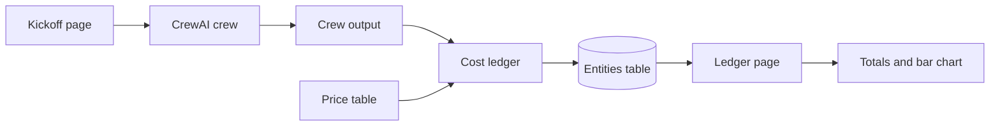

# Crew Cost Ledger

Token and cost accounting for every agent run, kept next to the crews that spend it.



## Why

Multi-agent crews are usually run overnight and the bill arrives a month later, long after anyone remembers which run it came from. The run history keeps the final answer but not the tokens, so nobody can say which agent, task or model burned the budget. The ledger writes the spend down at the moment each run finishes, in the same database that already holds the crews, so the answer is one page away.

## How it works

The Kickoff page builds a CrewAI crew from the stored agents and tasks, runs it in a background thread and captures the console. When the run returns, the cost ledger reads the token usage off the crew output, prices each model from a small table keyed by provider and model, and saves one cost record per run through the same entity store the rest of the app uses. The Ledger page reads those records back and totals them by crew and by day.

The feature added on top of the studio is the ledger itself. `app/cost_ledger.py` holds `MODEL_PRICES`, `extract_token_usage` for pulling tokens per agent, task and model out of a crew output, `estimate_cost` for turning tokens into money, and `record_run_cost` for saving a record. `app/pg_ledger.py` is the page that lists recent records and draws the per-crew and per-day totals. `app/db_utils.py` gained `save_cost_record` and `load_cost_records` over the `cost_record` entity type, and `app/pg_crew_run.py` calls `record_run_cost` after a successful kickoff, logging a warning and keeping the run if the record cannot be written. A model missing from the price table is recorded with zero cost rather than failing the run.

## Key decisions

- Cost records live in the existing `entities` table instead of a new schema, so the ledger works on SQLite and PostgreSQL without a migration; the cost is that totals are computed in Python after loading the records rather than by a SQL aggregate.
- Prices sit in a plain dictionary in `app/cost_ledger.py` rather than a remote price service, which keeps the app offline and fast; the cost is that prices are updated by editing the file.
- An unknown model is recorded with zero cost instead of raising, so a run is never lost to accounting; the cost is that a new model silently shows as free until its price is added.
- The record is written after the run finishes rather than streamed during it, which adds one write to the end of a run; the cost is that a run killed mid-flight leaves no record.

## Tech stack

- Python 3.12
- Streamlit for the pages
- CrewAI for the crews, agents and tasks
- SQLAlchemy over SQLite by default, PostgreSQL when `DB_URL` is set
- Docker and docker-compose for the app and the database

## Quick start

Prerequisites: Python 3.12, and Docker with docker-compose if you want the containerised setup.

```bash
pip install -r requirements.txt
streamlit run ./app/app.py
```

With Docker:

```bash
docker compose up --build
```

| Variable | What it sets | Default |
| --- | --- | --- |
| `DB_URL` | SQLAlchemy connection string for the entity store | `sqlite:///crewai.db` |
| `AGENTOPS_ENABLED` | Turns AgentOps session tracking on for runs | unset, treated as off |
| `AGENTOPS_API_KEY` | Key used when AgentOps tracking is on | unset |
| `POSTGRES_USER` | Database user for the compose Postgres service | unset |
| `POSTGRES_PASSWORD` | Database password for the compose Postgres service | unset |
| `POSTGRES_DB` | Database name for the compose Postgres service | unset |

## Usage

Run a crew from the Kickoff page, then open the Ledger page. The records it reads look like this:

```text
crew            day         runs   tokens     cost
research-crew   2025-03-11     4   182,400   $0.91
research-crew   2025-03-12     6   241,050   $1.24
support-triage  2025-03-12     3    96,700   $0.38
```

## Project structure

```text
app/
  app.py            entry point and page registry
  pg_crew_run.py    kickoff, background run, result saving
  pg_ledger.py      ledger page with totals and chart
  cost_ledger.py    price table, usage extraction, cost records
  db_utils.py       entity store over SQLAlchemy
  my_crew.py        crew model and CrewAI construction
  i18n/             page strings
tests/
  test_cost_ledger.py
  test_tool_ids.py
```

## Limitations

- Prices are a static table, so a provider price change needs a code edit.
- A run that is stopped or crashes before it returns leaves no cost record.
- Totals are computed in Python after loading every record, which is fine for thousands of runs and not for millions.
- Only token-based models are priced; tools with their own per-call fees are not counted.

## License

MIT. The licence text is in LICENSE.
